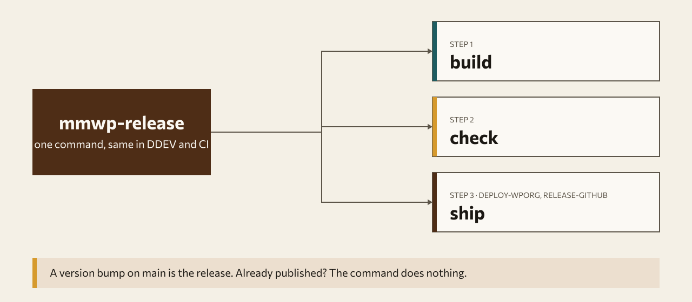

<h1 align="center">
<picture>
  <source media="(prefers-color-scheme: dark)" srcset="docs/assets/banner-dark.svg">
  
</picture>
</h1>

<p align="center">
  <a href="https://packagist.org/packages/mammothwp/wp-release"></a>
  <a href="https://packagist.org/packages/mammothwp/wp-release"></a>
  <a href="composer.json"></a>
</p>

Prepare, verify and ship a Mammoth WP plugin release to **wordpress.org** (SVN) and **GitHub Releases**.
One PHP CLI, `mmwp-release`, that behaves identically in DDEV and in GitLab CI.

**Release model: a version bump on `main` is the release.** There are no git tags. Every command compares the
plugin's own `Version` header with what is already published and does nothing when it is already out, so the
whole pipeline is safe to run on every push to `main`.

## How it works

<picture>
  <source media="(prefers-color-scheme: dark)" srcset="docs/assets/diagram-dark.svg">
  
</picture>

## Install

```bash
composer require --dev mammothwp/wp-release
vendor/bin/mmwp-release --help
```

The package is published on Packagist as `dev-main` (no version tags) and mirrored to
<https://github.com/mammothwp/wp-release>. Requires PHP >= 8.1 and these tools on `PATH`:
`composer`, `rsync`, `zip`, `unzip` (build); `wp` (WP-CLI) and `curl` (check, HTTP); `svn` (deploy-wporg).
For `check` with the default SQLite database PHP also needs `pdo_sqlite`.
In GitLab CI everything runs on the `composer:2` image (Alpine) plus apk packages, e.g.
`apk add --no-cache rsync zip unzip curl bash`, and `subversion` in the job that runs `deploy-wporg`.

## Commands

All commands accept the global flags below. Results go to stdout (table or JSON); logs, including every
external command that is run, go to stderr.

| Command | What it does |
|---|---|
| `build` | Fresh `composer install --no-dev --optimize-autoloader` in a temp copy (the working tree's `vendor/` is never touched), requires `.distignore`, rsyncs to `dist/<slug>/`, zips to `<slug>.zip`, validates headers/readme/forbidden files, prints zip size and file count. |
| `check` | Throwaway WordPress in a temp dir (SQLite drop-in, or MySQL), installs Plugin Check, unzips the **built** zip (builds first if the zip is missing or older than the sources), activates it, runs `wp plugin check`, writes `plugin-check.json` and `plugin-check.txt`, removes the site. Fails on any ERROR (and any WARNING with `--strict`). |
| `deploy-wporg` | Needs a passing check. Skips (exit 0) if `tags/<version>` already exists on `plugins.svn.wordpress.org`, or if the plugin has no SVN repo yet. Otherwise syncs trunk (+ `.wordpress-org/` → assets), `svn cp trunk tags/<version>` and commits. |
| `release-github` | Skips (exit 0) if release `v<version>` exists in `mammothwp/<slug>`. Otherwise creates it with the matching `readme.txt` changelog section as notes and uploads `<slug>.zip`. |
| `status` | Prints slug, header version, readme Stable tag, whether the version exists on wordpress.org and GitHub, and what each deploy command would do. |
| `all` | `build` → `check` → `deploy-wporg` → `release-github`, stopping at the first failure. |

### Global flags

| Flag | Meaning |
|---|---|
| `--dry-run` | Publish nothing. `deploy-wporg` prints the `svn status` diff and stops before commit; `release-github` prints the planned release. |
| `--debug-mode` | Verbose: stream command output, also print the Plugin Check table. |
| `--force` | Skip the "passing check required" gate of `deploy-wporg`. Never overwrites a published version. |
| `--path=<dir>` | Plugin repository root (default: current directory). |
| `--format=table\|json` | Result format on stdout (default `table`). |
| `--slug=<slug>` | Plugin slug (see configuration). |

Command specific: `check` / `all`: `--strict`, `--deps=<slugs>` (see [Plugin dependencies](#plugin-dependencies)), `--self-test`, `--keep`, `--db=sqlite|mysql`;
`deploy-wporg` / `all`: `--fail-if-unapproved`; `deploy-wporg`: `--strict`;
`check` / `all` / `deploy-wporg`: `--allow=<regex>` (repeatable, see [Plugin Check allow-list](#plugin-check-allow-list)).

## Configuration

Precedence: CLI flag > `MMWP_*` environment > `mmwp-release.json` > auto-detection.

**Slug:** `--slug`, `MMWP_SLUG`, `slug` in `mmwp-release.json`, else the single root `*.php` file with a
`Plugin Name:` header (file name without `.php`). The main file must be `<slug>.php`.

**`mmwp-release.json`** (optional, plugin root):

```json
{
  "slug": "my-plugin",
  "php_min": "7.4",
  "wp_version": "6.8",
  "strict": false,
  "allow": [],
  "excludes": ["*.psd", "docs/*"],
  "github_repo": "my-plugin"
}
```

`php_min`: the `Requires PHP` header must be at least this. `wp_version`: WordPress version of the check site
(overridden by `WP_VERSION`). `strict`: same as `MMWP_PCP_STRICT`. `allow`: same as `MMWP_PCP_ALLOW` (array of regexes). `excludes`: extra forbidden-file patterns
(`fnmatch`, matched against each path and file name in the zip).

### Plugin dependencies

Plugins with a `Requires Plugins:` header cannot be activated alone. Set `MMWP_BROWSER_DEPS="woocommerce"` (or `--deps=woocommerce`,
which overrides the variable) and `check` runs `wp plugin install <slug> --activate` for each slug before activating the plugin under
test. Plugin Check still checks only the plugin under test. Unset/empty keeps the old behaviour; if the header is present and no
dependencies are given, `check` fails (exit 2) naming `MMWP_BROWSER_DEPS`.

### Plugin Check allow-list

Strict mode fails on any Plugin Check warning. A narrow allow-list lets known, reviewer-approved warnings through:
`--allow=<regex>` (repeatable), `MMWP_PCP_ALLOW` (newline- or `||`-separated) and `allow` in `mmwp-release.json` are merged.
Nothing is allowed by default.

- A finding is allowed only if it is a **WARNING** and the regex matches the string `<code>: <message>`. **ERRORs can never be allowed.**
- Regexes are bare PCRE bodies without delimiters, matched with the `u` flag; use inline flags such as `(?i)`. An invalid regex exits with code 2.
- Allowed findings are listed as `ALLOWED: <code>: <message> (rule: <regex>)` in `plugin-check.txt` and on the console, the counts read
  `N error(s), M warning(s), K allowed`, and `plugin-check.json` gets `allowed` and `allowed_findings`. `warnings` excludes allowed
  findings, so the strict exit-20 decision and the `deploy-wporg` gate ignore them.

Recommended rule for the "MammothWP" brand: wordpress.org reviewers approve "BrandWP" names, but Plugin Check warns
`trademarked_term` for the "wp" in "MammothWP". This allows only that term, only when the quoted name/slug contains `mammothwp`
(not `wordpress`, `woocommerce`, or other brands):

```
(?i)^trademarked_term: (?=.*(?<![a-z0-9])mammothwp)(?=.*restricted term \W?wp\W)
```

```sh
mmwp-release check --strict --allow='(?i)^trademarked_term: (?=.*(?<![a-z0-9])mammothwp)(?=.*restricted term \W?wp\W)'
```

### Environment variables

| Variable | Used by | Meaning |
|---|---|---|
| `MMWP_SLUG` | all | Plugin slug. |
| `MMWP_DEBUG` | all | `true` = same as `--debug-mode`. |
| `MMWP_PCP_STRICT` | check, deploy-wporg | `true` = fail on Plugin Check warnings too. |
| `MMWP_PCP_ALLOW` | check, deploy-wporg | Plugin Check allow-list regexes, newline- or `||`-separated (see below). |
| `MMWP_BROWSER_DEPS` | check | wordpress.org slugs (space/comma separated) installed and activated in the temp site before the plugin; `--deps` overrides it. |
| `MMWP_SELF_TEST` | check | `true` = same as `--self-test`. |
| `MMWP_DB` | check | `sqlite` (default) or `mysql`. |
| `MMWP_DB_HOST` / `MMWP_DB_USER` / `MMWP_DB_PASS` / `MMWP_DB_NAME` | check | MySQL connection (name defaults to a random `mmwp_check_*`, dropped afterwards). |
| `MMWP_FAIL_IF_UNAPPROVED` | deploy-wporg | `true` = exit 32 instead of 0 when the plugin has no SVN repo yet. |
| `MMWP_GITHUB_OWNER` | release-github, status | GitHub owner (default `mammothwp`). |
| `MMWP_GITHUB_REPO` | release-github, status | GitHub repo (default: the slug). |
| `WP_VERSION` | check | WordPress version, default latest. |
| `WPORG_USERNAME` / `WPORG_PASSWORD` | deploy-wporg | SVN credentials. Masked in all output. |
| `GITHUB_TOKEN` | release-github | Token with `contents: write` on the repo. Masked in all output. |

## Exit codes

| Code | Meaning |
|---|---|
| 0 | Success, **already released**, or **plugin not yet approved** (unless `--fail-if-unapproved`) |
| 1 | Unexpected error |
| 2 | Usage / configuration error (no slug, bad flag, missing `.distignore`, missing credentials) |
| 3 | Required tool missing (`rsync`, `zip`, `svn`, ...) |
| 10 | Build failed (composer, rsync, zip) |
| 11 | Validation failed (headers, readme, version mismatch, forbidden files) |
| 20 | Plugin Check errors (or warnings with `--strict`) |
| 21 | Temp site setup or plugin activation failed |
| 22 | `wp mmwp self-test` failed |
| 30 | `deploy-wporg` refused: no passing `plugin-check.json` for this slug and version |
| 31 | SVN failure or wordpress.org unreachable |
| 32 | Plugin not approved yet and `--fail-if-unapproved` set |
| 40 | GitHub API failure or missing `GITHUB_TOKEN` |

## What `build` validates

- `<slug>.php` exists; headers `Text Domain` == slug, `Requires PHP`, `Requires at least`, `License` (GPL), `Version`.
- `readme.txt` exists with `Stable tag` and `Tested up to`; header `Version` == readme `Stable tag`.
- The zip contains no `.git`, `node_modules`, `tests`, `phpunit*`, `phpcs*`, `phpstan*`, `.gitlab-ci.yml`,
  `.wordpress-org`, `.env*`, `*.log`; `composer.lock` only if `vendor/` ships. Inside `vendor/` only the
  secret-like patterns apply (third-party packages legitimately ship tests).
- Pre-flight (exit 11, offending paths listed, before Plugin Check): the zip contains no hidden file or directory at any
  level (dot-files, dot-dirs, including inside `vendor/`) and no `*.phar`.
- `.distignore` (rsync exclude syntax) is required and is itself never shipped.
- Runtime dependencies (exit 11): when `composer.json` `require`s anything besides `php`/`ext-*`/`lib-*`, the zip must contain
  `vendor/autoload.php`, `vendor/composer/autoload_real.php` and `autoload_classmap.php`, and a `vendor/<name>/` directory for every
  package in the plugin's `composer.lock` `packages` (non-dev; metapackages skipped). Typical cause: a bare `vendor` line in
  `.distignore`. Plugin Check does not notice a zip like that.
- `.distignore` warning (fails the build with `--strict` / `MMWP_PCP_STRICT`): an unanchored entry (no leading `/`) named `tests`,
  `docs`, `bin`, `README.md`, `composer.lock` or `vendor` also strips those files inside `vendor/` packages; write `/tests` etc.

## What `build` copies

In a git work tree `build` ships only **tracked** files (`git ls-files`), then applies `.distignore`, then adds the fresh
no-dev `vendor/`. Untracked CI leftovers (`.cache/composer`, a downloaded `wp-cli.phar`, a tools dir, stray files) can
never reach the zip, and `.distignore` does not need to know about CI internals. Without git, the whole tree is copied
minus every dot-file/dot-dir, `*.phar`, `.cache/`, `node_modules`, `dist`, the zip itself and the directory named by
`MMWP_TOOLS_DIR` (when inside the plugin root).

## Local usage (DDEV)

```bash
ddev composer require --dev mammothwp/wp-release
ddev exec vendor/bin/mmwp-release build
ddev exec vendor/bin/mmwp-release check            # add --strict, --self-test, --keep
ddev exec vendor/bin/mmwp-release status
ddev exec vendor/bin/mmwp-release deploy-wporg --dry-run
```

Use `--db=mysql` with `MMWP_DB_HOST=db MMWP_DB_USER=db MMWP_DB_PASS=db` to reuse DDEV's database service.

## CI

Plugins get these jobs through `mammothwp/ci-templates` (job and file names there may differ; the commands are what
matters). The jobs boil down to:

```yaml
stages: [build, check, release]

mmwp-build:
  tags: [docker]
  stage: build
  script: [vendor/bin/mmwp-release build]
  artifacts: { paths: ["*.zip", "dist/"] }

mmwp-check:
  tags: [docker]
  stage: check
  script: [vendor/bin/mmwp-release check]
  artifacts: { when: always, paths: [plugin-check.json, plugin-check.txt] }

mmwp-release:
  tags: [docker]
  stage: release
  rules: [{ if: $CI_COMMIT_BRANCH == $CI_DEFAULT_BRANCH }]
  script:
    - apk add --no-cache rsync zip unzip curl bash subversion
    - vendor/bin/mmwp-release deploy-wporg
    - vendor/bin/mmwp-release release-github
```

Required CI variables (masked, protected): `WPORG_USERNAME`, `WPORG_PASSWORD`, `GITHUB_TOKEN`; optional `MMWP_*`
as above. Because every release command is idempotent, the release job can run on every push to `main`.
See [docs/ci.md](docs/ci.md) and [docs/release-model.md](docs/release-model.md).

## Development

```bash
composer install
vendor/bin/phpcs && vendor/bin/phpstan analyse && vendor/bin/phpunit --testsuite unit
vendor/bin/phpunit --testsuite integration   # real build + check; needs wp-cli, network and pdo_sqlite
```

## License

GPL-2.0-or-later. Support: info@mammothwp.com · <https://mammothwp.com>
